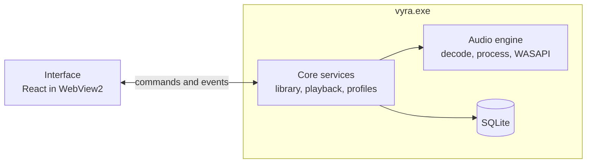
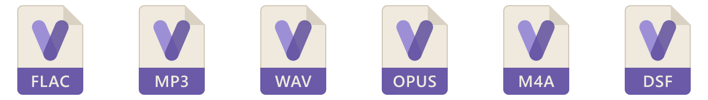

<p align="center">
  
</p>

<h1 align="center">VYRA</h1>

<p align="center">A local music center for Windows. Your music, your space.</p>

<p align="center">English · <a href="README.ru.md">Русский</a></p>

## Status

Design stage. There is no runnable build yet.

- The architecture is written down in [docs/architecture](docs/architecture/README.md).
- The system icon set is built by a script in [tools/icons](tools/icons).
- Twelve prototypes come next. They test the risky parts on real Windows machines before the application code starts.

## What VYRA is going to be

VYRA plays a music collection that lives on your own disk. It works without an internet connection.

| Area | Plan |
| --- | --- |
| Audio engine | Rust, direct WASAPI output in shared and exclusive modes, gapless playback, device switching without a restart |
| Bit-perfect | The engine reports the whole signal path. When playback is not bit-perfect, it names the stage that changes the sound |
| Playback context | A track opened from an album continues the album. A single file opened from Explorer plays alone and stops |
| Library | Several root folders, background scanning, albums told apart by edition, CUE sheets, smart playlists |
| Tag editor | Batch editing on the level of Mp3tag: format strings, tag and filename converters, actions, numbering. Nothing is written to a file without a command |
| Interface | Every page is a layout document. A layout builder, a sidebar editor, workspaces and a theme engine let you rearrange and restyle all of it |
| Profiles | One shared collection with separate playlists, ratings, history and settings for each person |
| Plugins | WebAssembly plugins with declared permissions for the interface, the core and the DSP chain |

MP3, FLAC, WAV, AIFF, ALAC, AAC, OGG Vorbis and Opus are supported from the start. WMA, APE, WavPack, TAK, TTA, MKA, AC3 and DTS come with an optional FFmpeg pack. DSD follows after version 1.0.

## Architecture



The audio engine runs on its own threads inside the Rust process. The interface lives in separate WebView2 processes, so a frozen or closed window does not stop the music.

Stack: Rust, Tauri 2, React, TypeScript, SQLite, Symphonia, WASAPI.

## Icons

<p>
  
</p>

The mark is two translucent bars that cross into a V. The app icon, the tray icon and fifteen file type icons all come from one vector geometry, fitted separately to every size from 16 to 256 px. The rules are in [docs/design/icons.md](docs/design/icons.md).

## Documentation

The design documents are written in Russian.

| Document | Contents |
| --- | --- |
| [Overview](docs/architecture/README.md) | system layout, stack, Rust crates, repository structure |
| [Audio engine](docs/architecture/audio-engine.md) | pipeline, decoders, WASAPI, gapless, bit-perfect |
| [Playback context](docs/architecture/playback-context.md) | context rules, queue, album detection |
| [Data model](docs/architecture/data-model.md) | SQLite schema, profiles, crash recovery, backups |
| [Metadata editor](docs/architecture/metadata-editor.md) | fields, format strings, actions, tag backends |
| [Interface](docs/architecture/ui-customization.md) | layouts, widgets, themes, interface copy rules |
| [Windows integration](docs/architecture/windows-integration.md) | frameless window, installer, file types |
| [Plugins](docs/architecture/plugins.md) | three plugin kinds, permissions, versioning |
| [Roadmap](docs/architecture/roadmap.md) | prototypes, MVP, versions up to 1.0 |
| [Decisions](docs/architecture/decisions.md) | open and settled decisions |

## Roadmap

1. Prototypes: WASAPI output, gapless, bit-perfect check, interface speed, scanner, frameless window, installer.
2. MVP: playback, library, playback context, dark theme.
3. Version 0.2: layout builder, sidebar editor, workspaces, themes.
4. Version 0.3: tag editor, file manager, CUE sheets, smart playlists.
5. Version 0.4: equalizer, DSP chain, FFmpeg pack.
6. Version 0.5: profiles, backups.
7. Version 1.0: installer, file associations, updates.

Plugins, local sync, DSD and ASIO follow after 1.0.

## Building

Only the icon set can be built today:

```
cd tools/icons
npm install
npm run build
```

The application build will need Rust, Node and the Microsoft C++ build tools.

## License

VYRA is licensed under [GPL-3.0](LICENSE).

Plugins that use only the published plugin API may carry any license. The draft wording is in [PLUGIN-EXCEPTION.md](PLUGIN-EXCEPTION.md).

## Credits

The interface design follows the [unslop](https://github.com/heydamir/unslop) guidelines by Damir Sokolovsky.
