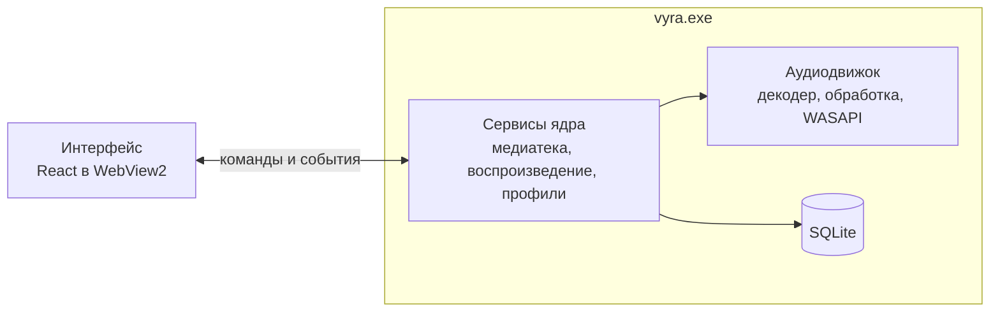
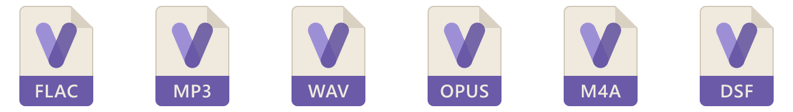

<p align="center">
  
</p>

<h1 align="center">VYRA</h1>

<p align="center">Локальный музыкальный центр для Windows. Ваша музыка, ваше пространство.</p>

<p align="center"><a href="README.md">English</a> · Русский</p>

## Состояние

Идёт проектирование. Запускаемой сборки пока нет.

- Архитектура записана в [docs/architecture](docs/architecture/README.md).
- Набор системных иконок собирает скрипт в [tools/icons](tools/icons).
- Дальше идут двенадцать прототипов. Они проверяют рискованные места на настоящих машинах с Windows до начала основного кода.

## Каким будет VYRA

VYRA играет коллекцию, которая лежит на вашем диске. Интернет для работы не нужен.

| Область | План |
| --- | --- |
| Аудиодвижок | Rust, прямой вывод через WASAPI в общем и монопольном режимах, gapless, смена устройства без перезапуска |
| Bit-perfect | Движок показывает весь путь сигнала. Когда воспроизведение не bit-perfect, он называет стадию, которая меняет звук |
| Контекст воспроизведения | Трек, открытый из альбома, продолжает альбом. Отдельный файл из проводника играет один и останавливается |
| Медиатека | Несколько корневых папок, фоновое сканирование, альбомы различаются по изданиям, листы CUE, умные плейлисты |
| Редактор тегов | Массовая правка на уровне Mp3tag: форматные строки, преобразования между тегами и именами файлов, действия, нумерация. В файл ничего не пишется без команды |
| Интерфейс | Каждая страница описана документом макета. Редактор макетов, редактор sidebar, рабочие пространства и движок тем позволяют переставить и перекрасить всё |
| Профили | Одна общая коллекция, у каждого человека свои плейлисты, рейтинги, история и настройки |
| Плагины | Плагины на WebAssembly с явными разрешениями: для интерфейса, ядра и цепочки DSP |

MP3, FLAC, WAV, AIFF, ALAC, AAC, OGG Vorbis и Opus поддерживаются с самого начала. WMA, APE, WavPack, TAK, TTA, MKA, AC3 и DTS приходят с необязательным пакетом FFmpeg. DSD появится после версии 1.0.

## Архитектура



Аудиодвижок работает в собственных потоках внутри процесса Rust. Интерфейс живёт в отдельных процессах WebView2, поэтому зависшее или закрытое окно музыку не останавливает.

Стек: Rust, Tauri 2, React, TypeScript, SQLite, Symphonia, WASAPI.

## Иконки

<p>
  
</p>

Знак состоит из двух полупрозрачных пластин, которые сходятся в V. Иконка приложения, иконка трея и пятнадцать иконок типов файлов построены из одной векторной геометрии и подогнаны отдельно под каждый размер от 16 до 256 px. Правила записаны в [docs/design/icons.md](docs/design/icons.md).

## Документация

| Документ | Содержание |
| --- | --- |
| [Обзор](docs/architecture/README.md) | общая схема, стек, крейты Rust, каталоги репозитория |
| [Аудиодвижок](docs/architecture/audio-engine.md) | конвейер, декодеры, WASAPI, gapless, bit-perfect |
| [Контекст воспроизведения](docs/architecture/playback-context.md) | правила контекста, очередь, определение альбомов |
| [Данные](docs/architecture/data-model.md) | схема SQLite, профили, восстановление, резервные копии |
| [Редактор метаданных](docs/architecture/metadata-editor.md) | поля, форматные строки, действия, движки тегов |
| [Интерфейс](docs/architecture/ui-customization.md) | макеты, виджеты, темы, правила текстов |
| [Интеграция с Windows](docs/architecture/windows-integration.md) | окно без рамки, установщик, типы файлов |
| [Плагины](docs/architecture/plugins.md) | три вида плагинов, разрешения, версии |
| [Roadmap](docs/architecture/roadmap.md) | прототипы, MVP, версии до 1.0 |
| [Решения](docs/architecture/decisions.md) | открытые и принятые решения |

## План

1. Прототипы: вывод WASAPI, gapless, проверка bit-perfect, скорость интерфейса, сканер, окно без рамки, установщик.
2. MVP: воспроизведение, медиатека, контекст воспроизведения, тёмная тема.
3. Версия 0.2: редактор макетов, редактор sidebar, рабочие пространства, темы.
4. Версия 0.3: редактор тегов, файловый менеджер, листы CUE, умные плейлисты.
5. Версия 0.4: эквалайзер, цепочка DSP, пакет FFmpeg.
6. Версия 0.5: профили, резервные копии.
7. Версия 1.0: установщик, типы файлов, обновления.

Плагины, локальная синхронизация, DSD и ASIO идут после 1.0.

## Сборка

Сейчас собирается только набор иконок:

```
cd tools/icons
npm install
npm run build
```

Для сборки приложения понадобятся Rust, Node и инструменты сборки Microsoft C++.

## Лицензия

VYRA распространяется под [GPL-3.0](LICENSE).

Плагины, которые пользуются только опубликованным API, можно выпускать под любой лицензией. Черновик оговорки лежит в [PLUGIN-EXCEPTION.md](PLUGIN-EXCEPTION.md).

## Благодарности

Дизайн интерфейса следует правилам [unslop](https://github.com/heydamir/unslop), их автор Damir Sokolovsky.
